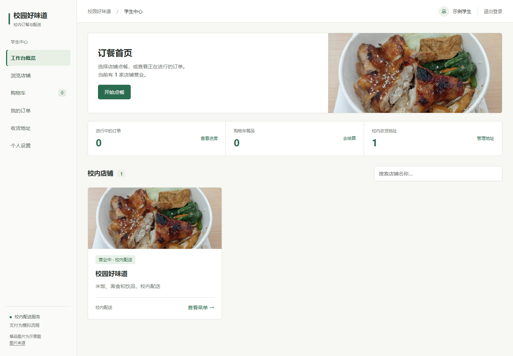
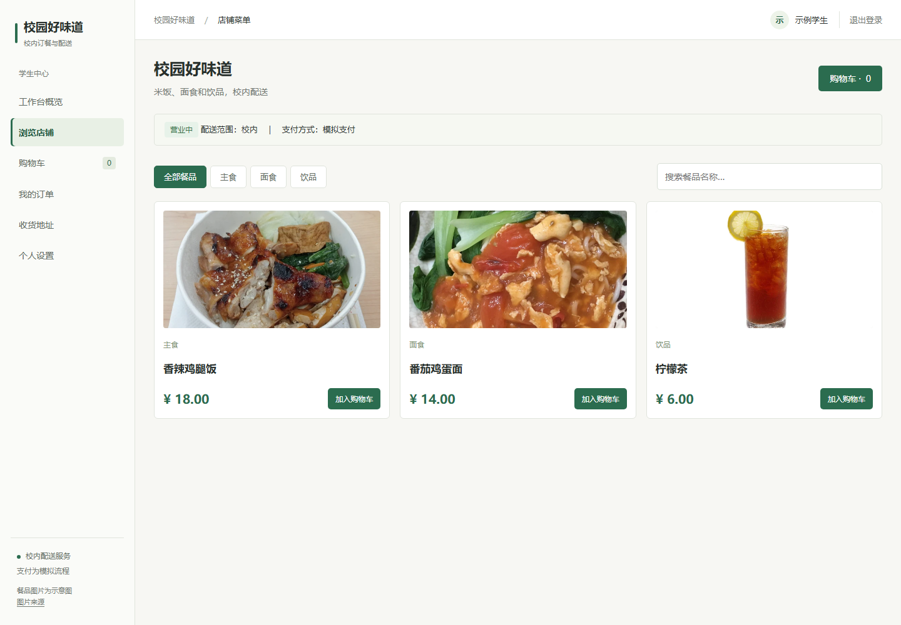

# 基于 Java Web 的校园外卖订餐与配送系统

## 项目证据与个人贡献

[负责模块与关键技术决策](docs/PORTFOLIO.md) · [当前架构说明](docs/architecture-overview.md) · [持续集成](.github/workflows/ci.yml)


### 演示截图





[截图来源与历史版本说明](docs/images/SOURCES.md)。当前支付为模拟流程。


毕业设计题目：**基于 Java Web 的校园外卖订餐与配送系统设计与实现**。

本项目交付一个可在浏览器运行的校园外卖系统，以及符合学校要求的毕业设计报告。学生在手机端订餐，商家处理订单，骑手配送，管理员维护平台。采用单体 Java Web 应用和响应式页面，手机、电脑均可使用。

## 指导材料与约束

原始材料为学校提供的毕业设计指导压缩包。实施和写作以其中的指导 PPT、附件 1 至 4 为准；成品示例和“参考”目录中的论文仅用于理解结构与形式，其中的人名、日期、题目、技术栈和文字内容不属于本项目要求，也不得照搬。

- 作品提交完整源代码、数据库文件、可运行程序及运行说明。
- 报告不少于 3000 字，参考文献至少 5 篇，实际查重率不超过 30%。查重结果须来自真实报告，不预设或伪造。
- 报告包含封面、目录、内容摘要与关键词、正文、参考文献；按附件准备诚信承诺书、评阅意见表和 PDF 查重报告。承诺书由学生本人签名；评阅表的成绩、评语和教师签名由评阅教师填写。
- 报告 Word 文件按“学号+姓名+毕业设计题目”命名。学号、姓名、班级等信息待本人提供，不使用示例中的个人信息。
- 指导 PPT 中的时间节点：2026-09-30 前定题，2026-12-20 前提交作品和初稿，2027-01-03 前提交终稿。

论文格式按附件 2 执行：A4 纸；上、下、左页边距各 20 mm，右页边距 15 mm；目录标题 3 号黑体居中、目录内容小 4 号仿宋；摘要标题 3 号黑体居中、摘要内容 5 号宋体，关键词通常不超过 5 个；正文另起页，标题 3 号黑体居中，正文小 4 号宋体、首行空两格、1.5 倍行距。一级标题用“一、”和 4 号黑体，二级用“（一）”，三级以下依次用“1、”“（1）”“①”。参考文献标题 4 号黑体、内容 5 号宋体；全文连续编页码，单面打印时页码在右下角。

## 技术栈

系统分层、模块关系和订单流转见 [docs/architecture.md](docs/architecture.md)。

| 层次 | 选型 | 职责 |
| --- | --- | --- |
| 语言与构建 | Java 17、Maven | 开发和打包 |
| Web | Spring Boot 3.5.16、Spring MVC、内嵌 Tomcat | 请求处理与可执行 JAR |
| 认证授权 | Spring Security | 表单登录、会话、角色权限、CSRF 防护 |
| 数据访问 | MyBatis Spring Boot Starter 3.0.5 | SQL 映射 |
| 数据库 | MySQL 8.4、InnoDB | 持久化、事务与约束 |
| 页面 | Thymeleaf、HTML5、CSS3、少量原生 JavaScript | 服务端渲染的响应式界面 |
| 测试 | JUnit、Spring Boot Test | 订单与权限等关键路径 |

Spring Boot 3.5 与 MyBatis Starter 3.0 的兼容范围均覆盖 Java 17；依赖版本以项目 `pom.xml` 锁定。参考：[Spring Boot 系统要求](https://docs.spring.io/spring-boot/3.5/system-requirements.html)、[MyBatis 兼容表](https://mybatis.org/spring-boot-starter/mybatis-spring-boot-autoconfigure/)、[MyBatis 3.0.5 构件](https://repo1.maven.org/maven2/org/mybatis/spring/boot/mybatis-spring-boot-starter/3.0.5/)。

## 功能范围

| 角色 | 功能 |
| --- | --- |
| 学生 | 注册、登录、浏览商家和菜品、管理购物车及校内地址、下单、模拟支付、查看进度、确认收货、查看历史订单 |
| 商家 | 登录、管理本店信息和菜品上下架、接单、标记制作完成、查看本店订单 |
| 骑手 | 登录、查看待配送订单、接单、标记配送中和已送达、查看本人任务 |
| 管理员 | 管理商家及骑手账号、停用违规账号或店铺、查看全站订单 |

学生可自行注册；商家和骑手账号由管理员创建，避免注册时自行提升权限。购物车一次只允许一家商家的菜品。仅支持校内地址，不接入真实支付、地图定位、短信、Redis、消息队列或微服务。模拟支付必须在页面和报告中明确标注。

### 订单流程

`待支付 → 待接单 → 制作中 → 待配送 → 配送中 → 待确认 → 已完成`

学生下单后模拟支付；商家接单并制作，制作完成后发布待配送任务；骑手接单、配送并标记送达；学生确认收货。学生可在商家接单前取消订单，取消后进入 `已取消`。同一订单只能由一名骑手接取，状态只能按合法顺序流转；各操作仅允许对应角色执行。

结算金额由服务端按菜品现价和数量重新计算，不信任浏览器提交的金额。订单创建时保存菜品名称、单价和地址快照；历史订单不因菜品改价或地址修改而改变。下单与订单状态变更使用数据库事务；骑手抢单使用带状态条件的更新，防止重复接单。用户密码使用 Spring Security 的密码编码器存储，敏感操作保留 CSRF 防护。

### 核心数据表

| 表 | 主要内容 |
| --- | --- |
| `users` | 账号、密码摘要、角色、状态、联系方式 |
| `shops` | 商家账号、店名、简介、营业状态 |
| `dishes` | 所属店铺、分类、名称、价格、图片路径、上下架状态 |
| `addresses` | 所属学生、校内楼栋/房间、联系人及电话 |
| `orders` | 订单号、学生、商家、骑手、金额、地址快照、状态、各阶段时间 |
| `order_items` | 订单、菜品名称和单价快照、数量、小计 |
| `order_events` | 订单状态变更、操作人、操作时间，用于追踪配送过程 |

## 实现与验收

先完成 Maven 项目、数据库脚本、登录和角色权限，再贯通“学生下单 → 商家接单 → 骑手配送 → 学生确认”的主流程，最后完善各角色页面、异常处理和文档。交付至少包括可运行 JAR、建库与示例数据 SQL、启动说明，以及覆盖金额计算、越权操作、非法状态跳转、重复抢单的可运行检查。

报告应依据**实际完成的系统**撰写需求分析、技术选型、总体设计、数据库设计、关键功能实现、测试结果和总结；截图和测试结果取自真实运行。学校格式与提交材料要求在最终制作报告时逐项核对。

## 当前可运行版本

项目已经包含可运行的 Spring Boot 网页端和完整的学生、商家、骑手、管理员主流程。页面入口为 `/`，默认端口为 `8080`。

### 本机启动

1. 创建数据库并执行表结构：

```powershell
mysql -uroot -p -e "CREATE DATABASE IF NOT EXISTS campus_takeaway CHARACTER SET utf8mb4 COLLATE utf8mb4_unicode_ci;"
Get-Content -Raw src/main/resources/db/schema.sql | mysql -uroot -p campus_takeaway
```

2. 配置数据库密码并启动：

```powershell
$env:DB_USERNAME="root"
$env:DB_PASSWORD="你的 MySQL 密码"
mvn spring-boot:run
```

也可以直接运行 `target/campus-takeaway-1.0.0.jar`。端口和数据库连接支持 `PORT`、`DB_URL`、`DB_USERNAME`、`DB_PASSWORD` 环境变量。

```powershell
$env:PORT="18081"
& "$env:JAVA_HOME\bin\java.exe" -jar target/campus-takeaway-1.0.0.jar
```

JAVA_HOME 应指向 Java 17 或更高版本的 JDK。本机 PATH 中的 java 为旧版本，启动时应使用 JAVA_HOME 的明确路径；本轮实际使用已安装的 JDK 23。

首次启动会自动创建演示账号和菜单：

| 角色 | 账号 | 密码 |
| --- | --- | --- |
| 学生 | `student` | `student123` |
| 商家 | `merchant` | `merchant123` |
| 骑手 | `rider` | `rider123` |
| 管理员 | `admin` | `admin123` |

学生可自行注册；商家和骑手账号只能由管理员创建。页面中的支付是模拟支付，不会产生真实扣款。

### 已验证主流程

学生登录后选择店铺和菜品，购物车结算并模拟支付；商家接单、标记制作完成；骑手条件抢单、标记送达；学生确认收货。订单金额由服务端按当前菜品价格计算，订单保存菜品和地址快照。

### 构建与检查

```powershell
mvn test
mvn package -DskipTests
```

普通测试覆盖金额重算、非法状态、越权商家操作和重复抢单条件。连接真实 MySQL 的集成测试还覆盖完整页面与表单流程、两名骑手并发抢单、重复下单和事务回滚。

Windows 下正在运行的 JAR 会占用文件；更新打包前先停止该应用，再执行打包与启动命令。

### 本轮功能补充

- 校内地址支持设为默认；删除默认地址后，自动选取剩余地址；结算页自动选中默认地址。
- 同一购物车提交重试返回原订单。购物车变化后旧表单会被拒绝，防止过期页面下单。购物车在单体应用会话中串行修改。
- 参数错误、越权操作和不存在的页面提供中文提示，并保留 HTTP 400、403、404 状态。
- 四种角色均可在“个人设置”修改姓名、手机号码和密码。改密须验证当前密码，成功后重新登录，其他设备的旧会话在下次访问时失效。
- 已完成或已取消的订单可“再来一单”，按当前可售餐品恢复数量，结算使用现价；原订单和地址快照保持不变。
- 桌面页面改为浅色侧栏、紧凑表格和菜单，去除装饰性英文与宣传文案，保留中文状态提示和模拟支付标注。
- 菜品照片、店铺封面及餐食配图保存在 `src/main/resources/static/images/`；购物车与商家菜单展示缩略图。图片均为演示用示意照片，作者与许可见 `/images/credits.html`。菜品已有 `image_path` 时优先使用该路径，未配置的演示餐品使用对应本地照片。

### 运行完整回归

```powershell
$env:DB_USERNAME="root"
$env:DB_PASSWORD="你的 MySQL 密码"
.\scripts\test.ps1 -MySQL
```

脚本使用本机 3306 端口，自动创建专用数据库 `campus_takeaway_test`。每个集成检查会清理这个测试库；不要在该库保存业务数据。演示系统的 `campus_takeaway` 不参与测试清理。数据库账号需要在测试库中建表和创建触发器的权限。只运行无需数据库的检查可使用 `.\scripts\test.ps1`。

本轮实测记录见 [docs/verification.md](docs/verification.md)，原始 JUnit 结果见 `target/surefire-reports/`。
