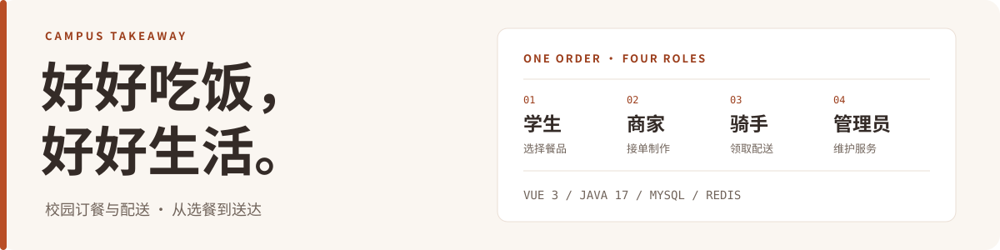
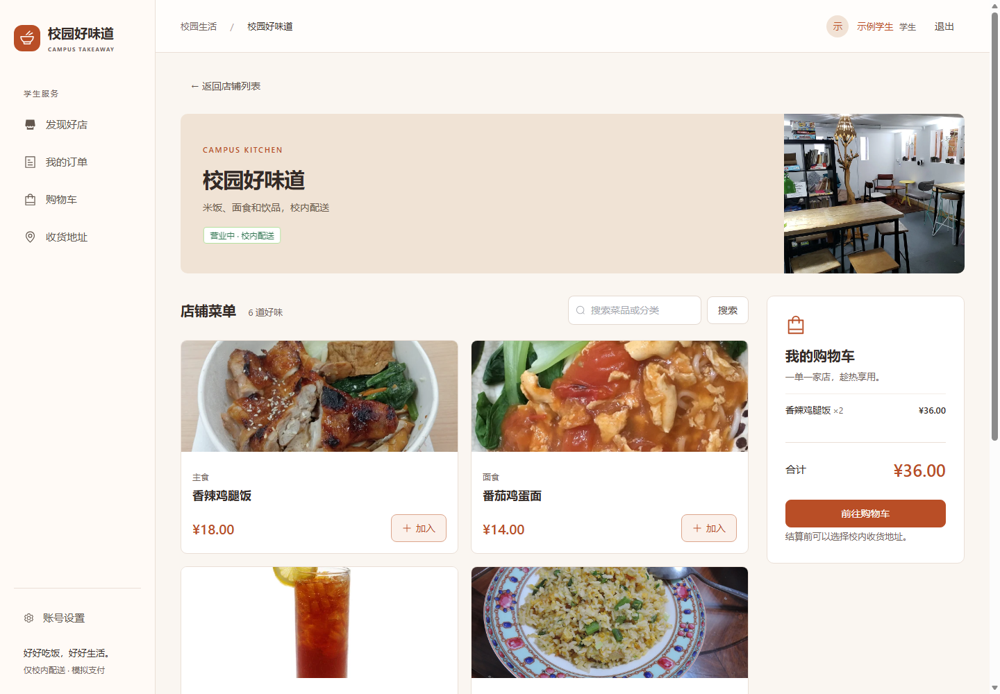
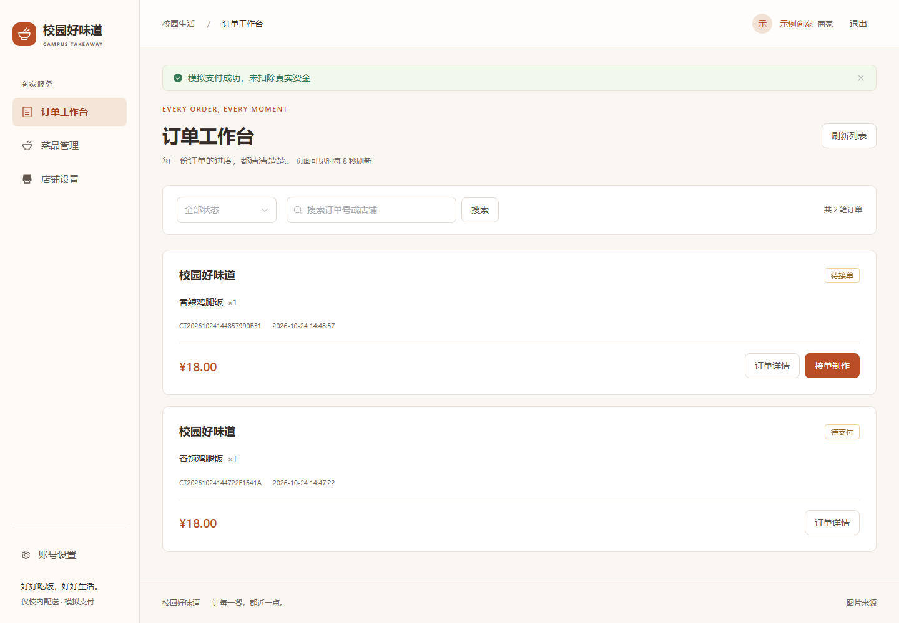
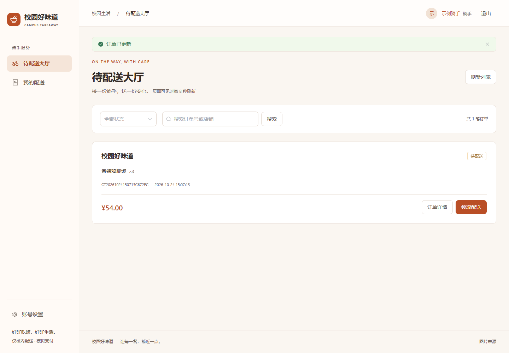
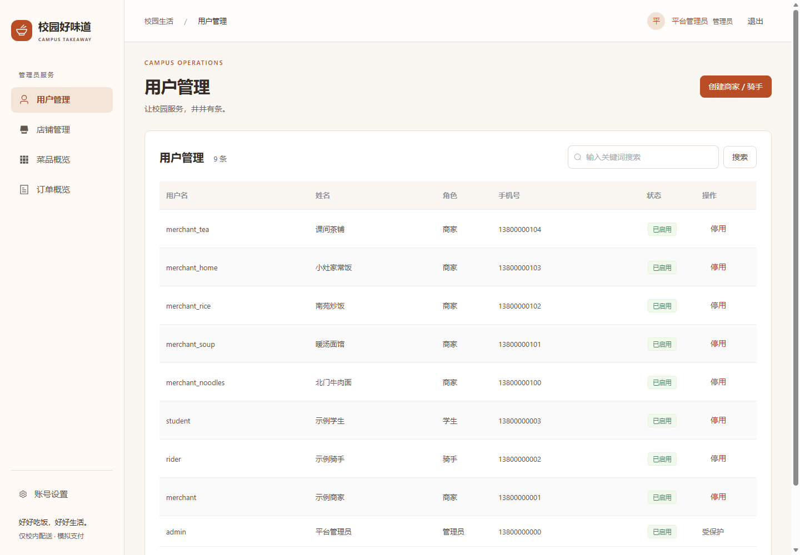
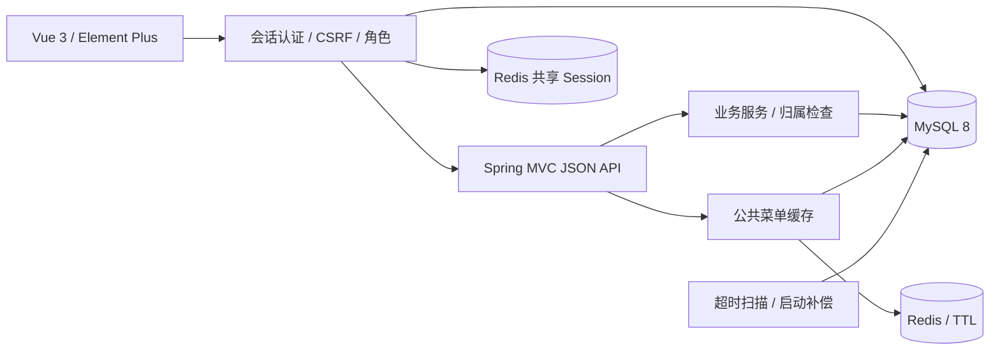

<p align="center">
  
</p>

<h1 align="center">校园好味道 · Campus Takeaway</h1>

<p align="center">
  从选餐到送达的完整校园外卖系统。<br>
  Vue 3 前后端分离 · Redis 共享登录与菜单缓存 · 数据库事务保障订单
</p>

<p align="center">
  <a href="https://github.com/17elr/campus-takeaway/actions/workflows/ci.yml"></a>
  <a href="pom.xml"></a>
  <a href="pom.xml"></a>
  <a href="web/package.json"></a>
  <a href="compose.yaml"></a>
  <a href="docs/verification.md"></a>
</p>

<p align="center">
  <a href="#preview">界面预览</a> ·
  <a href="#quick-start">快速开始</a> ·
  <a href="#quality">测试验证</a> ·
  <a href="docs/README.md">文档中心</a>
</p>

## 项目简介

校园好味道围绕一份订单，串联**学生选餐、商家制作、骑手配送、学生确认收货**，由管理员维护用户与店铺。支持一个 JAR 同源交付，也可通过 Vue 开发服务器与后端分别运行。

项目在原 Java Web 版本上完成 Vue / Redis 升级，重点实现数据库购物车、跨实例幂等结算、共享会话和订单状态一致性。**支付为模拟，不会产生真实扣款。**

<a id="preview"></a>

## 界面预览

<table>
  <tr>
    <td width="50%" align="center">
      <strong>学生 · 选餐下单</strong><br><sub>店铺、购物车与订单</sub><br><br>
      <a href="docs/screenshots/student-menu.png"></a>
    </td>
    <td width="50%" align="center">
      <strong>商家 · 接单制作</strong><br><sub>菜品、制作与店铺</sub><br><br>
      <a href="docs/screenshots/merchant-orders.png"></a>
    </td>
  </tr>
  <tr>
    <td width="50%" align="center">
      <strong>骑手 · 配送任务</strong><br><sub>待配送与本人任务</sub><br><br>
      <a href="docs/screenshots/rider-available.png"></a>
    </td>
    <td width="50%" align="center">
      <strong>管理员 · 用户管理</strong><br><sub>账号、店铺与订单</sub><br><br>
      <a href="docs/screenshots/admin-users.png"></a>
    </td>
  </tr>
</table>

截图来自真实浏览器与隔离演示数据，点击可查看原图。[浏览全部 15 张截图、移动端与订单时间线 →](docs/SHOWCASE.md)

<a id="features"></a>

## 功能与设计

| 面向谁 | 已实现的业务 |
| --- | --- |
| 学生 | 注册登录、店铺菜单、单店购物车、校内地址与默认地址、模拟支付、取消、确认收货、再来一单 |
| 商家 | 自有店铺与营业状态、菜品分类/价格/上下架、接单、制作完成 |
| 骑手 | 待配送大厅、条件抢单、本人配送、标记送达 |
| 管理员 | 创建商家/骑手、用户启停、店铺启停、菜品与订单概览 |
| 共用 | 资料与改密、角色导航、订单详情、事件时间线、字段校验与错误反馈 |

| 工程重点 | 实现方式 | 代码入口 |
| --- | --- | --- |
| 持久化购物车与幂等结算 | 用户行锁串行化修改与结算；版本/请求凭证/唯一键保护重放；订单、快照、事件与清空购物车同事务 | [CartService](src/main/java/cn/campus/takeaway/cart/CartService.java) · [OrderService](src/main/java/cn/campus/takeaway/service/OrderService.java) |
| 安全共享登录 | Redis Session、会话编号轮换、CSRF、可信当前用户、认证版本与 BCrypt；改密/停用使旧会话失效 | [auth](src/main/java/cn/campus/takeaway/auth/) |
| 公共菜单缓存 | 60–75 秒 TTL、短时负缓存、提交后失效与故障回源；成交价重新读 MySQL | [MenuCache](src/main/java/cn/campus/takeaway/cache/MenuCache.java) |
| 真实分页与批量明细 | SQL 筛选后分页，本页订单明细一次 IN 查询加载 | [AppMapper](src/main/java/cn/campus/takeaway/mapper/AppMapper.java) |
| 订单超时与并发配送 | 15 分钟未支付条件取消、30 秒扫描与启动补偿；条件 UPDATE 保证抢单单赢家 | [OrderExpiry](src/main/java/cn/campus/takeaway/service/OrderExpiry.java) |

<a id="quick-start"></a>

## 快速开始

准备 Docker Compose，克隆仓库后启动：

```sh
git clone https://github.com/17elr/campus-takeaway.git
cd campus-takeaway
cp .env.example .env
# 编辑 .env，替换 DB_PASSWORD 和 MYSQL_ROOT_PASSWORD，再启动
docker compose up --build -d
```

打开 [http://127.0.0.1:8080](http://127.0.0.1:8080)。`.env.example` 为首次体验启用示例数据；仅在用户表为空时创建以下账号：

| 角色 | 用户名 | 示例密码 |
| --- | --- | --- |
| 学生 | `student` | `student123` |
| 商家 | `merchant` | `merchant123` |
| 骑手 | `rider` | `rider123` |
| 管理员 | `admin` | `admin123` |

数据库使用持久化命名卷，停止服务使用 `docker compose stop`。示例账号仅供本地演示；公网部署前关闭示例数据、更改示例密码，HTTPS 启用 `COOKIE_SECURE=true`。

[本地开发、环境变量、端口与 JAR 构建 →](docs/QUICKSTART.md) · [旧数据升级与回退 →](docs/MIGRATION.md)

<a id="architecture"></a>

## 系统架构



| 层次 | 技术 |
| --- | --- |
| 前端 | Vue 3、Vue Router、Element Plus、JavaScript、原生 Fetch、Vite |
| 后端 | Java 17、Spring Boot 3.5.16、Spring MVC、MyBatis 3.0.5 |
| 数据与会话 | MySQL 8、Redis、Spring Session、Flyway、BCrypt |
| 构建与验证 | Maven、Node 24、Docker Compose、GitHub Actions、JUnit、真实浏览器 |

[完整订单状态图与事务边界 →](docs/architecture.md)

<a id="quality"></a>

## 测试验证

| 验证 | 已记录的结果 | 证据 |
| --- | --- | --- |
| Java | **36 项通过，0 跳过**：9 单元 + 26 MySQL/Redis 集成 + 1 迁移测试 | [测试结果](docs/test-results.json) |
| 前端 | **4 项通过**：Fetch / CSRF / 错误处理、轮询并发与中止；生产构建通过 | [测试源码](web/tests/) |
| 真实浏览器 | **17 条检查**：四角色订单闭环、375/768/1440 布局与图片、浏览器异常 0 | [浏览器结果](docs/screenshots/browser-results.json) |
| 数据回退演练 | 旧版 JAR 可读取新订单，9 张业务表摘要保持一致 | [回退结果](docs/rollback-results.json) |
| CI | Java 17 + MySQL 8 + Redis 7、Vue、Compose 校验与 Docker 构建 | [Actions](https://github.com/17elr/campus-takeaway/actions/workflows/ci.yml) |

以上是实际验证记录。支付为模拟，未进行生产负载测试；缓存 SQL 次数与测量边界见[验证报告](docs/verification.md)。

## 仓库导航

```text
campus-takeaway/
├── web/                       # Vue 页面、Fetch 与前端测试
├── src/main/java/.../         # JSON API、认证、购物车、缓存与业务服务
├── src/main/resources/db/     # Flyway 迁移与演示菜单
├── src/test/                  # 单元、真实服务集成与迁移验证
├── docs/                      # 接口、架构、数据字典、截图与验收记录
├── scripts/                   # 验证、浏览器闭环与回退检查
├── compose.yaml               # MySQL / Redis / 应用编排
└── Dockerfile                 # Vue + Java 多阶段构建
```

[文档中心](docs/README.md) · [API 契约](docs/API.md) · [数据字典](docs/DATA_DICTIONARY.md) · [面试讲解](docs/INTERVIEW.md) · [版本记录](CHANGELOG.md)

原 Java Web 到 Vue / Redis 的升级记录见 [PR #2](https://github.com/17elr/campus-takeaway/pull/2)，旧提交与图片来源保留。现有数据库切换请先阅读[迁移手册](docs/MIGRATION.md)。
