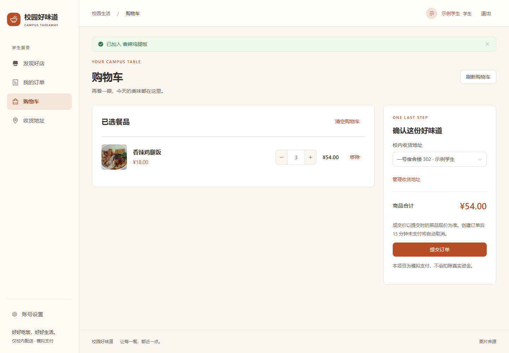
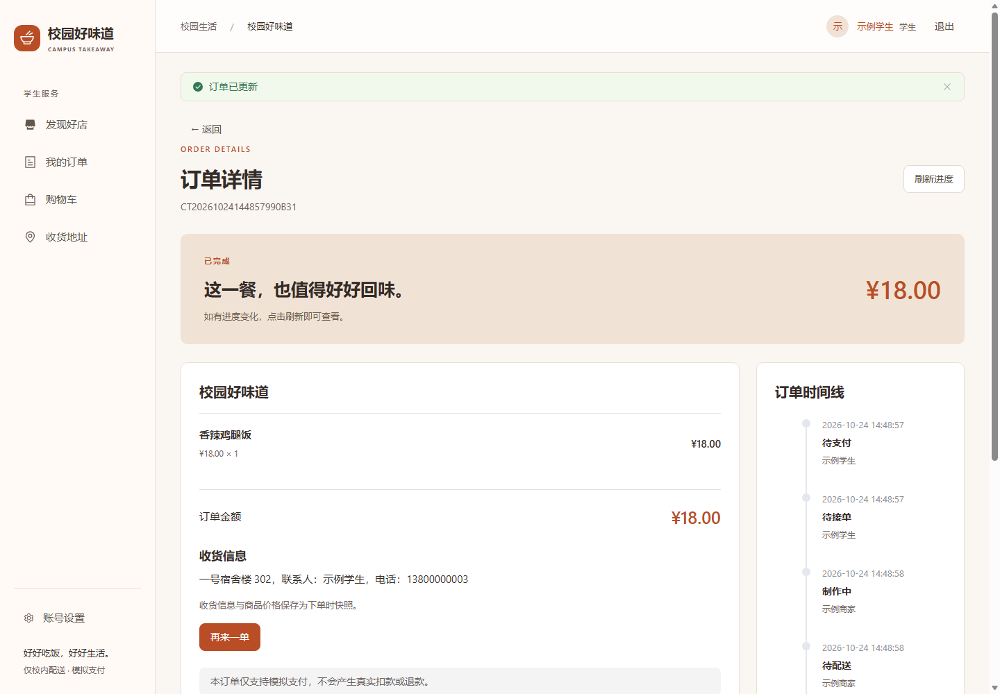
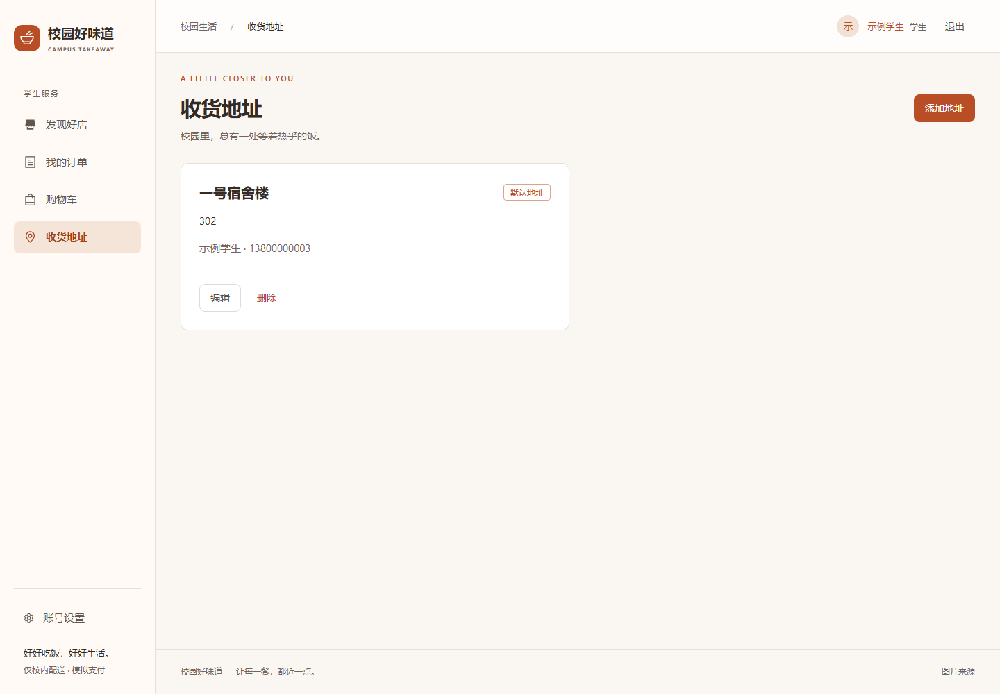
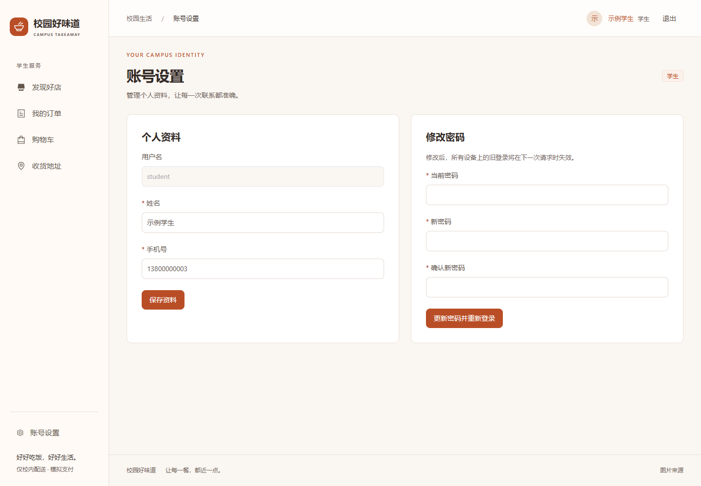
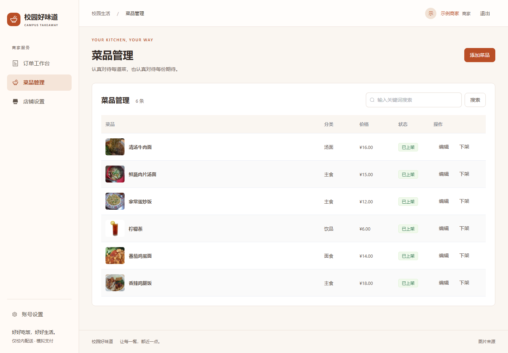
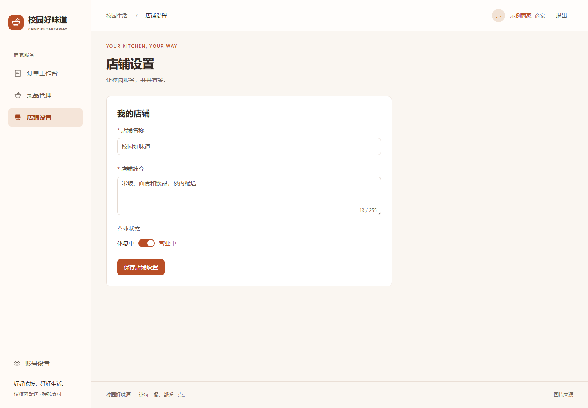
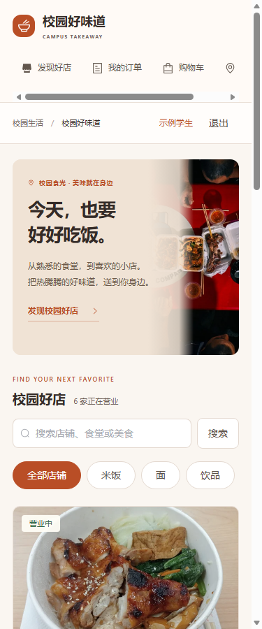
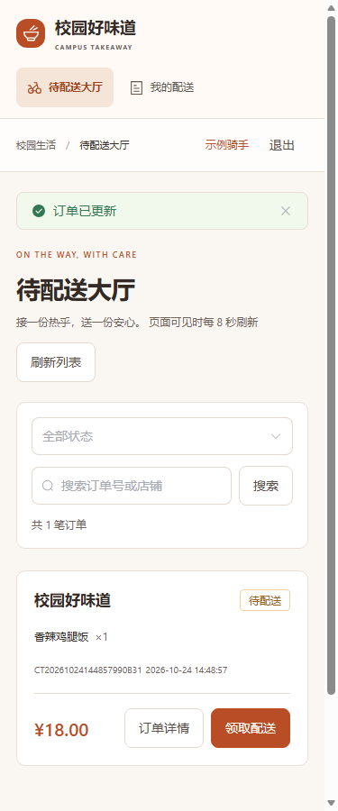
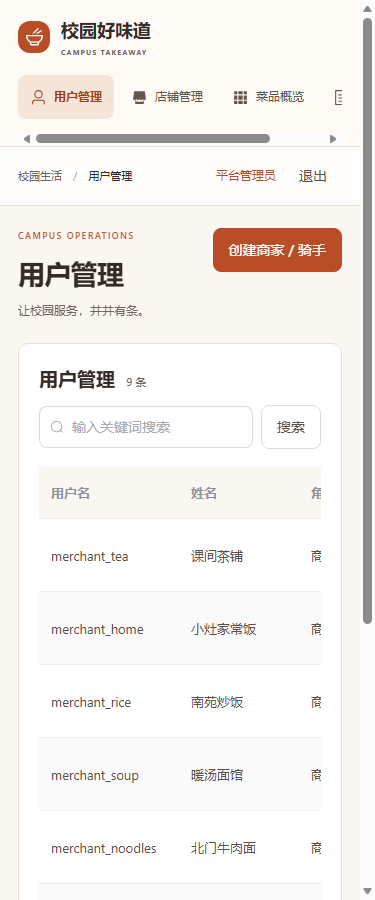

# 界面图册

[返回项目首页](../README.md) · [文档中心](README.md)

以下 15 张图片来自 Edge 真实浏览器和独立演示数据库，页面宽度覆盖 375、768、1440 像素。账号、电话号码和订单均为演示数据。点击图片可查看原尺寸，[运行记录](screenshots/browser-results.json)对应学生下单、商家制作、骑手配送到确认收货的实际流程。

## 学生端

| 发现店铺 | 菜单与购物车 |
| --- | --- |
|  |  |

| 核对餐品与收货地址 | 完成订单与事件时间线 |
| --- | --- |
|  |  |

| 校内地址 | 账号资料与改密 |
| --- | --- |
|  |  |

## 商家端

| 菜品分类、现价与上下架 | 店铺名称、简介与营业状态 |
| --- | --- |
|  |  |

## 骑手与管理员

| 骑手 · 待配送大厅 | 管理员 · 用户管理 |
| --- | --- |
|  |  |

## 移动端与平板

| 375px · 学生发现页 | 375px · 骑手配送大厅 | 375px · 管理员列表 |
| --- | --- | --- |
|  |  |  |

展开 768px 平板布局

## 复现截图

截图未拼接或改写页面数据。运行 `scripts/browser-smoke.mjs` 可在隔离演示库重跑真实订单闭环并生成图片；环境、CDP 与命令说明见[验证报告](verification.md#截图与复现)。照片授权与出处保留在 [credits.html](../src/main/resources/static/images/credits.html)。
