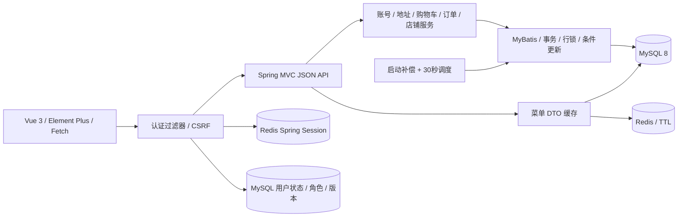
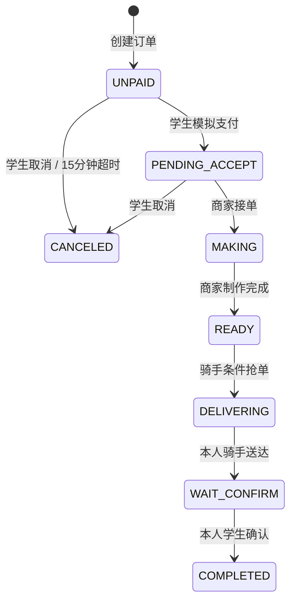

# 架构与订单状态

购物车修改与结算首先锁 users 当前行，再读购物车/幂等结果。同 key 同参数返回旧订单，同 key 改版本/地址返回 409。创建、明细快照、初始事件、清空购物车在同一事务；任何失败保留原购物车。

抢单继续以数据库条件 UPDATE 竞争，影响 1 行才写事件。支付带未超时条件；取消、状态更新与事件均同事务，超时更新也带 UNPAID + expires_at 条件，不依赖前端计时器或 Redis 锁。

Redis 共享 Session 解决多实例登录，并不能串行化多实例的业务事务。菜单缓存只加速公共展示；提交后删除与并发回填存在短暂旧值窗口，TTL 限定存活，成交时重新读数据库。

默认菜单第一页缓存，其余页/搜索执行数据库分页。订单列表使用主表分页 + 单次 IN 批量明细，避免 N+1。轮询只存在于本次新增的 Vue 商家/骑手活跃订单页。
