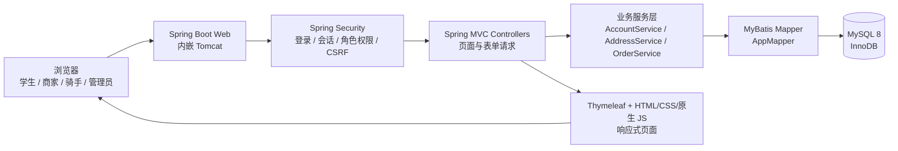
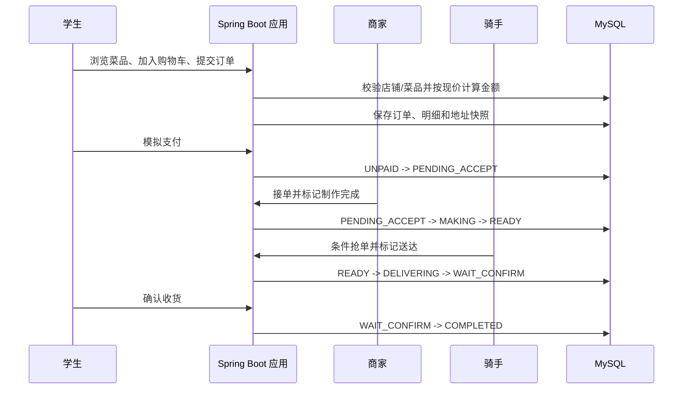
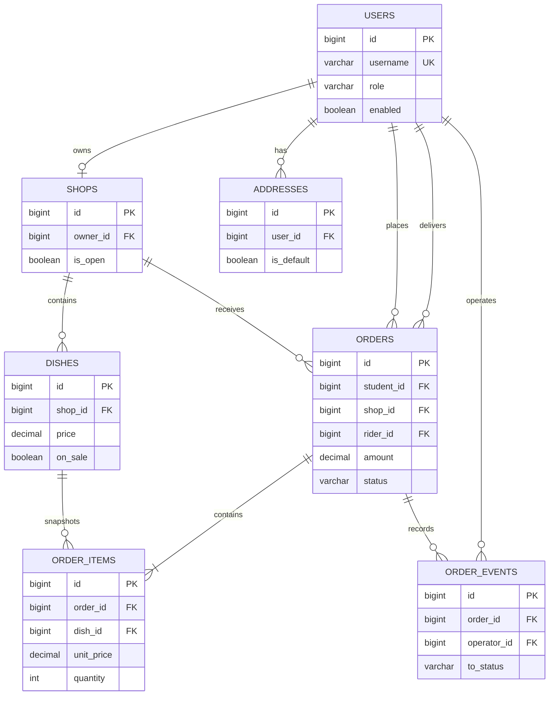

# 系统架构

## 总体架构

项目采用单体 Java Web 架构，不拆分微服务，不依赖 Redis、消息队列、地图或真实支付服务。

## 模块划分

| 模块 | 主要代码 | 职责 |
| --- | --- | --- |
| 页面层 | `src/main/resources/templates/`、`static/` | 服务端渲染页面、样式、交互和表单 |
| 控制器层 | `controller/` | 路由、角色入口、参数接收和页面跳转 |
| 业务层 | `service/` | 下单、支付、状态流转、地址和账户规则 |
| 安全层 | `config/SecurityConfig.java`、`ActiveAccountFilter.java` | 登录、密码编码、角色授权、CSRF、停用账号失效 |
| 数据访问层 | `mapper/AppMapper.java` | MyBatis SQL 查询、插入、更新和条件抢单 |
| 领域模型 | `domain/` | 用户、店铺、菜品、购物车、订单和状态对象 |
| 数据库层 | `src/main/resources/db/schema.sql` | 表结构、外键、状态和数量约束 |

## 核心业务流

## 数据关系

## 设计要点

- 订单金额由服务端重新计算，不信任浏览器提交的金额。
- 订单明细保存菜品名称、单价和地址快照，避免历史订单随资料修改变化。
- 订单写入和状态变更使用事务；骑手抢单使用带状态条件的更新，保证同一订单只被一人接取。
- 页面支付为模拟支付，不连接真实支付渠道。
